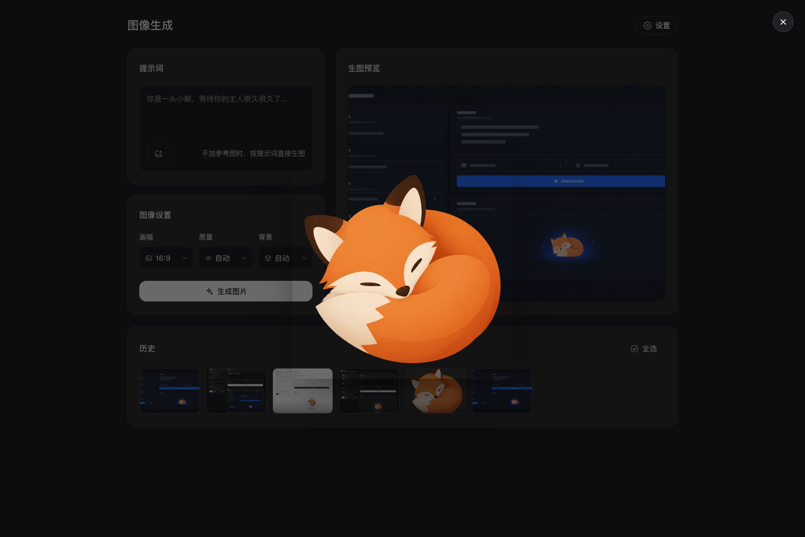
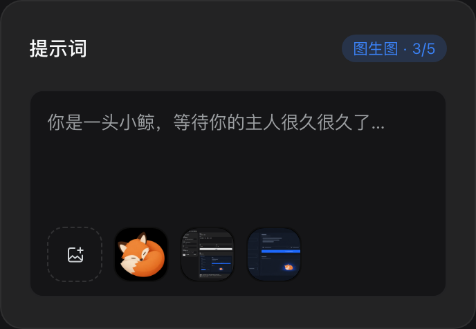
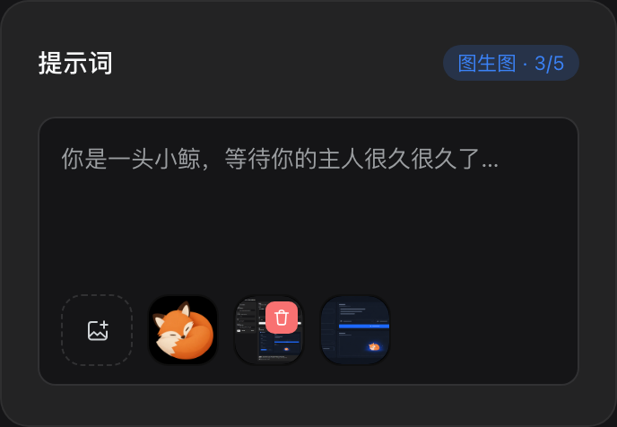
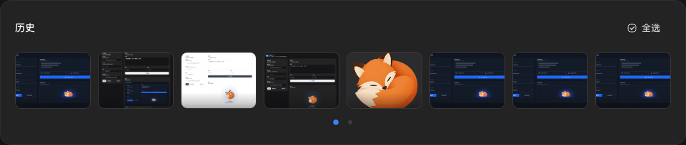
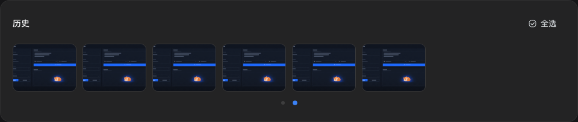
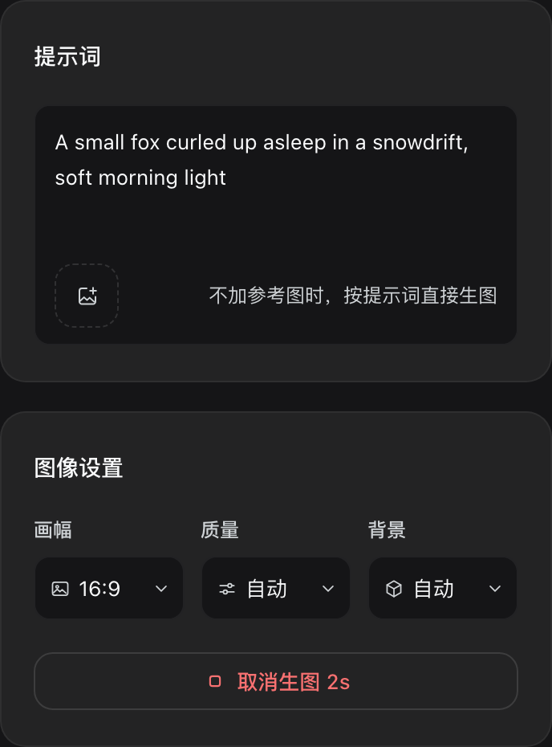
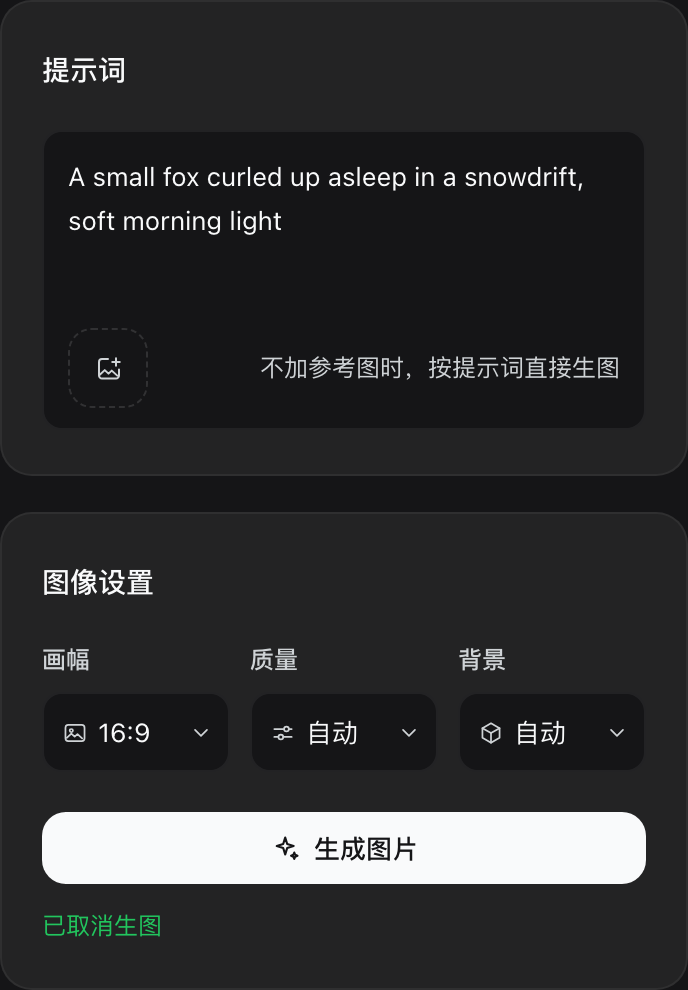

# Image studio（图像生成）

一个 DSH Harness 插件：在 Web UI 左侧栏新增「图像生成」页面，填写**接口地址**与 **API Key** 后，
输入提示词即可调用生图接口，图片会保存到本地并进入页面右侧的画廊。

同时注册两个 agent 工具——`image2_generate`（生成）与 `image2_edit`（改图）——复用同一套配置。

仓库：<https://github.com/Mr-Maidong/dsh-plugin-image2>（topic：`dsh`、`dsh-plugin`、`deepseek-harness`）

## 安装

```bash
# 从 GitHub 安装
dsh plugin --profile desktop add git+https://github.com/Mr-Maidong/dsh-plugin-image2.git

# 或用本地克隆
git clone https://github.com/Mr-Maidong/dsh-plugin-image2.git
dsh plugin --profile desktop add ./dsh-plugin-image2
```

Host 半侧在启动时加载，装好需要重启 DSH；之后只改 `client.js` 的话刷新页面即可。

## 使用

1. 打开左侧栏的「图像生成」图标。**第一次进入会自动弹出接口设置**；已经配好密钥时，设置收在
   标题栏右上角的「设置」按钮里。
2. 设置里填写：
   - **接口地址**：生图接口的基础地址，例如 `https://api.openai.com/v1`。
     也可以直接粘贴完整路由 `https://api.openai.com/v1/images/generations`，插件会自动截掉后缀。
   - **API Key**：只需填写一次，保存后不再回显（页面只显示掩码提示）。
   - **模型**：默认 `gpt-image-2.5`。
   - **输出目录**：默认 `~/Pictures/image2`，支持以 `~` 开头的路径。
   - **超时时间（秒）**：默认 `180`，可填 5–900（超出会被夹到这个区间，填非数字会被拒）。它管的是
     一次生图/改图以及结果下载的总时长，超过就中断本次请求并提示「无法连接接口」；「测试连接」不受它影响，
     始终是 20 秒的快速探测。
3. 点「保存」（第一次保存后弹窗会自己关掉），可先点「测试连接」确认地址与密钥可用（探测 `{接口地址}/models`）。
4. 左列写提示词、选画幅、质量与背景，点「生成图片」。等待期间同一个按钮变成**「取消生图 Ns」**
   （红色描边 + 停止方块图标，N 是这次请求已经跑过的秒数），**点它就取消**：页面把这次运行的 id
   发给 Host，Host 直接中断对接口的那次请求——所以取消是真的停下，不会在后台继续出图、继续扣费。
   取消后按钮变回「生成图片」，下面一行绿字「已取消生图」，历史里不会多出记录。
   三者默认 **16:9 / 自动 / 自动**（存在 profile 里，
   页面上切换后只影响本次，不改设置文件）。背景取 `自动 / 透明 / 不透明`：选「透明」时接口返回带 alpha
   的 PNG，适合做空态插图、贴纸这类要抠底的素材（接口是否支持取决于你自己的服务实现）。
5. 提示词框的**左下角**是参考图入口：一个字都还没挑时，右侧写着一行「不加参考图时，按提示词直接生图。」，
   点虚线方块里的「添加参考图」选 1–5 张图片。**不传参考图走文生图**（`/images/generations`），
   **传了就自动走图生图**（`/images/edits`，多张一起送过去），此时说明文字消失、按钮变成「图生图」、
   卡片右上角出现「图生图 · N/5」。参考图只在本页内存里（`URL.createObjectURL`），不会写进磁盘；
   单张 ≤ 14 MB（JSON 里要按 base64 传送，超出网关的数据 URL 上限会被拒），非图片或超过 5 张会被 Host 拒绝并给出提示。
   - 移除：指针移到某张图上，右上角出现删除按钮（和历史缩略图一样）；触屏设备上一直显示。
   - 看大图：点参考图本身，用 Harness 自己的图片预览弹层看原图（见下）。
6. 右列是「生图预览」：整张图**铺满**预览框（`object-fit: cover`，比例不同时裁掉溢出部分，不会拉变形），
   和左边「提示词 + 图像设置」两栏等高，不附带路径、改写、文件信息。点这张图会打开 Harness 原生的
   图片预览弹层，按原尺寸看整张图。下面是通栏的历史卡片，
   缩略图固定 4:3，**一行放得下多少就放多少**（最多 8 张），放不下的分页：底部一排小圆点标出页码，
   当前页是品牌蓝，点任一圆点直接跳页；只有一页时不显示圆点。
   - **看大图**：点缩略图本身，打开同一个原生预览弹层（`/api/image2/asset` 给的是原图字节，不是缩略图）；
   - **选**：鼠标移到缩略图上，底部滑出工具条——底衬是一条自下而上渐隐的暗色蒙层（底部最深、向上
     淡到全透明，没有硬边），左边勾选框、右边垃圾桶。**选中只由勾选框负责**，点图是看大图、不会顺手
     改选中；选中的图在指针移开后只留底部左侧的勾选标记（蒙层与垃圾桶隐去，不压图）；卡片右上角的
     「全选」一次选中全部，满选后变成「取消选择」；
   - **删一张**：工具条右侧的垃圾桶按钮；
   - **批量删**：选中若干（或全选）后点右上角红色的「删除所选 / 全部删除」；
   - 两种删除都会先弹**二次确认**（列出数量，说明只删记录、不动文件），确认后才真正移除。

历史只删除记录，**磁盘上的图片文件不会被删**。

## 实现

| 部分 | 位置 | 说明 |
| --- | --- | --- |
| Host 半 | `index.js` | 读写设置与历史；在 `/api/image2/*` 上注册六个需要鉴权的路由；注册两个工具 |
| Client 半 | `client.js` | `sidebar.panellist` 图标 + 以 `image2` 为 key 的 `main` 页面 |
| 组合 | `cordis.patch.yml` | 插入一行 `id: image2` 的插件行 |

路由（都在 Connection 的 `/api` 鉴权通道上，浏览器同源 `fetch` 即可）：

- `GET|POST /api/image2/settings` — 读取/更新设置；`POST` 只写入传入的字段。
- `POST /api/image2/test` — 探测 `{接口地址}/models`。
- `POST /api/image2/generate` — 调用 `{接口地址}/images/generations`（`response_format: b64_json`），
  写盘后返回 `{ item, items }`：新记录与刷新后的整份历史。
  同一个路由也收 `multipart/form-data`：`prompt` / `size` / `quality` / `background` 四个字段，
  外加 1–5 个 `reference` 图片分片。这时改调 `{接口地址}/images/edits`，记录写成 `kind: 'edit'`。
  图生图的 body 走**JSON + base64**：图片编码成 `data:image/png;base64,...`，放进
  `images: [{ image_url }]`——这是这套模型网关唯一读得懂的写法（`image` 字符串、`image[]` 数组、
  multipart 都会被一句 `The request body must be JSON.` 挡回来）。兼容端点如果只认 multipart，
  路由会按 `images` → `image` → multipart `image` → multipart `image[]` 的顺序试过去，**只在响应像
  「读不懂 body」时才换下一种**（真正开始出图后的报错绝不重发，避免重复扣费）；一旦哪种被接受就记住，
  后续请求直接用它，不再重新试探。四种写法全被拒时，报错里会带上每一种的结果
  （`… [body spellings tried: images=500 image=500 multipart-image=500 multipart-image[]=500]`），
  这样「端点真的拒绝」和「跑的还是旧版本」不会长得一模一样。
- `GET /api/image2/history` — 历史列表，新的在前。
- `POST /api/image2/history/delete` — 按 `{ ids: [...] }` 删除记录，返回剩余历史。
- `POST /api/image2/cancel` — 按 `{ requestId }` 中断正在跑的那次生图：请求带上 `requestId` 时，
  路由把「这次运行」登记进一张表，`cancel` 找到它就 abort 掉对接口的那次请求（超时与页面断开也接在同一个
  signal 上）。取消成功返回 `{ cancelled: true }`；id 已经跑完或根本不存在时返回 `{ cancelled: false }`
  而不是报错，所以迟到的点击不会变成一个红色错误。
- `GET /api/image2/asset?id=` — 回传某条记录的图片字节（`` 直接用它，页面因此不必在 JSON 里搬运 base64）。

工具：

- `image2_generate(prompt, size?, quality?, background?, outputDir?)` — 生成一张并返回落盘路径。
- `image2_edit(image, prompt, mask?, size?, quality?, background?, outputDir?)` — 调 `/images/edits` 改图，
  结果写成**新文件**，原图不动。

`background` 取 `auto`（默认）/ `transparent` / `opaque`：`transparent` 出带 alpha 的 PNG（做空态插图、贴纸
这类素材时用），`opaque` 强制不透明，`auto` 交给接口决定。不传时用设置里保存的值，设置里也没有就按
`auto`。页面本身没有这个开关，只对两个工具和 `POST /api/image2/generate` 生效。

两个工具与页面共用同一套超时：设置里的「超时时间（秒）」对它们同样生效（工具由 Agent 触发，没有取消入口，
但到点会中断并返回错误）。

工具在**工作区**里调用时默认写入 `<工作区>/imgout`（而不是设置里的图片目录），这样 agent 生成的图
就落在它的工作旁边；显式传 `outputDir` 时以参数为准。

## 界面

页面样式不是凭空写的：先用 `gpt-image2` 生成一张界面设计稿，再照着稿子在 `client.js` 里还原。
外框对齐其他一级页面（`ui-schedule` 的任务页、插件页）：960px 居中列、`clamp(24-48px)` 左右内边距、
标题 20px/28px/500、标题行上边距 28px（macOS 再叠加 `--dsh-frame-top-clearance`，让标题避开窗口顶部那条
拖拽区），右上角是 32px 的操作胶囊——这个插件的操作就是「设置」，原来左下角那个悬浮入口已经去掉。
标题下面是两行：第一行左边是「提示词 + 图像设置」，右边是「生图预览」——两栏**底部对齐**（网格
`align-items: stretch`，左列最后一张卡吃掉余量），预览图 `object-fit: cover` 铺满整张卡片，框底固定黑色
（深浅两套主题都是黑，像看图工具的底板，不跟随卡片层次色）；
第二行是通栏的「历史」卡片，缩略图固定 4:3，一行一页，页码用底部的圆点表示。

- 只用 Harness 自己的设计变量（`--dsw-alias-*`）和 `ui-primitives` 的 `Button` / `Menu` / `ImageLightbox`，
  深浅两套主题都跟随应用。
- **不自带字体**：全文只用 DSH 的主字体（`--dsw-font-family`），插件里没有任何 font-family 字体栈——
  连诊断用的等宽行 `.i2-detail` 也是主字体，不引入 `ui-monospace` / `SFMono-Regular` / `Menlo`。
- **图片预览直接复用宿主能力**：`@deepseek-ai/dsh-client-ui-primitives` 在 shell 的共享模块表里
  （`seed.ts` 把整个命名空间发给每个 fetch bundle），所以 `client.js` 里 `require` 到的 `ImageLightbox`
  就是会话图片附件和 Markdown 正文图片用的那一个弹层：portal 到 `body`、Esc / 点遮罩 / 关闭按钮都能关、
  关闭后把焦点还给触发元素、遮罩从 `--dsh-frame-chrome-top` 下面开始画。三处入口（生图预览大图、
  历史缩略图、参考图）共用一个 `.i2-zoom` 类：铺满容器 + `cursor: zoom-in` + 内描边聚焦环（这些容器都是
  `overflow: hidden`，外描边会被裁掉）。宿主若没有导出这个组件，点击就是无操作，不会让整页挂掉。
- 提示词卡片是**一个整体**：边框、聚焦环、底色都在外层容器上，`<textarea>` 无边框地待在它里面，
  参考图条是它的左下角页脚。因此聚焦时亮起来的是整个框，参考图看起来是长在输入框上而不是叠在下面。
- 参考图条一排六个大圆角方块：虚线框的入口 + 最多 5 张预览，圆角与缩略图一致。每个槽 `flex: 1 1 0` 且上限 40px，
  于是「5 张图 + 1 个按钮」在任何卡片宽度下都正好排在一行（窄了按比例一起缩小，不会换行）；
  卡片顶到上限后入口变灰禁用。没有参考图时右侧那行说明会和入口同排，上传后整行就只属于图片。
- 唯一的固定色是这个插件的品牌蓝 `#3b82f6`，只在聚焦描边、选中描边、选中数量胶囊和当前页圆点上出现；
  主按钮仍然用 `Button variant="primary"`，因此和其它页面保持一致。
- 历史一行能放几张不是写死的常量：卡片量一次自己的宽度，按缩略图 84px 的下限算出列数（上限 8），
  再把这一页渲染成一个等分网格；`ResizeObserver` 在窗口变化时重算。因此页码数、圆点数与实际能看到的
  张数永远一致，窄面板下也不会把缩略图挤成一条缝。
- 空态插图来自 `design/empty.webp`（600px 透明 WebP），缩到 400px 宽后以 data URL 内联进 `client.js`
  （页面因此不需要额外的静态资源路由）。
- 侧栏图标是给定的那枚「相框 + 山 + 星」形状，用 `currentColor` 单色填充，因此选中态跟随侧栏自己的配色。
- 画幅、质量与背景不是原生 `<select>`：它们的弹层直接用宿主的 `Menu` 基元（`ui-primitives`），
  因此卡片、行高、悬停底色、右侧勾选和应用里其它下拉菜单完全一致；触发器仍是本页的输入框样式，
  通过 `portal` 渲染到 `body`，不会被面板的滚动容器裁掉。三项并排一行，该行的触发器收窄了内边距与
  图标尺寸，最长的「不透明」也不会被截断（英文用 Auto / Clear / Solid 这三个短词）。
- 设置弹窗是 `position:fixed` + `createPortal` 到 `body` 的自绘对话框，不依赖宿主的 `Modal`，
  这样它不会被页面容器的 `overflow` 或层叠顺序裁掉。


















`design/` 里是这些素材与开发工具：

| 文件 | 用途 |
| --- | --- |
| `comp.png` | `gpt-image2` 生成的界面设计稿，还原时照着它写 |
| `preview.html` | 开发预览：用 React + 假的 slots/locale/Button/Menu/fetch 直接渲染 `client.js`，可截图比对设计稿（`Menu` 替身只模拟 props 与行结构，卡片外观来自宿主基元，预览里不作为视觉依据） |
| `serve.mjs` | 预览用的本地服务：静态文件 + `/api/image2/asset`（`` 不走 `fetch`，必须有真实路由） |
| `vendor/` | 预览页用的 React 18.3.1 UMD 构建（原本从 unpkg 拉，离线会白屏，现改为本地文件） |
| `check-client.mjs` | 无浏览器自检：中英词条是否对齐、代码里用到的 key 是否都存在、slot 是否注册 |
| `empty.webp` | 空态插图原图（600×499 透明） |
| `empty-inline.webp` | 实际内联的那份：缩到 400px 宽、WebP q84 |
| `empty-dataurl.txt` | 上面那份的 data URL |
| `inline-art.mjs` | 把 `empty-dataurl.txt` 写回 `client.js` 的 `ART_EMPTY` |
| `fox.webp` | 更早一版的空态插图，现已不用，仅留档 |
| `shots/` | 截图：深色画廊、浅色画廊、深色空态、原生预览弹层、参考图（有图/悬停删除）、生图中与取消后（超时时间在设置弹窗里）、勾选与批量删除入口、工具条渐变、历史分页（第一页/第二页）、二次确认弹窗、设置弹窗、图像设置、画幅下拉、图标各尺寸；另有三张旧图兼作预览页里的历史缩略图 |

改完 `client.js` 想看效果，不必反复装插件：

```powershell
node design/serve.mjs 39181
# 打开 http://127.0.0.1:39181/design/preview.html
```

`?theme=light|dark`、`?lang=en|zh`、`?nokey=1`（模拟未配置密钥，弹窗自动打开）、
`?empty=1`（模拟空历史）、`?count=14`（把历史撑长，用来看分页与圆点）、
`?delay=2600`（把生成接口的返回拖慢，用来看按钮上的计时）。
换了插图就跑一次 `node design/inline-art.mjs`。
这个预览页只替代宿主环境，不是插件的运行方式。

## 设置与历史存储

都在 `$DSH_PROFILE_DIR/image2/`（未设置该环境变量时回落到 `~/.dsh/image2/`）：

- `settings.json` — 写入时使用 `0600` 权限。API Key 只存在于这个文件与插件进程内存中：
  - 接口永远不把 Key 回传给浏览器，只返回 `hasApiKey` 与形如 `••••abcd` 的掩码。
  - Key 在每次调用时重新读取，因此保存后立刻对下一次生成、`image2_generate` 与 `image2_edit` 生效，无需重启。
  - 删除密钥：页面上的「删除密钥」，或直接删除该 `settings.json`。
  - 除地址/模型/输出目录外，还存 `size`、`quality`、`background`、`timeoutSeconds` 四个偏好
    （默认 `16:9` / `auto` / `auto` / `180`）；工具调用时显式传参优先，其次是这里的值，最后才是代码默认值。
- `history.json` — 画廊记录（最多 200 条，新的在前），每条含 id、绝对路径、媒体类型、字节数、
  提示词、模型改写、生成方式（`generate` / `edit`）与时间。文件损坏时按空画廊处理。
  删除记录只改这个文件，图片本体留在原处。

## 注意

- 「测试连接」依赖接口实现 `/models`；部分兼容实现没有该路由，此时测试会报错，但不影响生成。
- 接口地址由使用者自己填写，插件只按 `{接口地址}/images/generations` 与 `/images/edits` 约定拼接；
  这是本机发起的出站请求，请只填写你信任的地址。
- 生成是慢请求（默认 180 秒超时），期间按钮处于禁用状态。

## 开发自测

- `node smoke.mjs`——在本机临时目录里起一个假的生图接口，跑通「设置读写 → 探测 → 生成落盘 → 历史/素材/
  删除 → 两个工具（含工作区 `imgout` 默认目录、JSON+base64 改图）→ 参考图（JSON 生图、`images[].image_url`
  数据 URL、多图、只认 multipart 的端点会一路回退到 `image[]`、超过 5 张 / 非图片 / 空分片 / 缺提示词）→
  超时设置（默认值、区间夹取、非数字被拒）→ 取消（未知 id 返回 `false`、中断后返回 `cancelled` 且不落盘、
  超时按设置秒数中断、页面断开同样中断）→ 各类错误分支」。它把
  `DSH_PROFILE_DIR` 指向临时目录，因此不会碰真实配置，也不访问外网。
- `node design/check-client.mjs`——加载 `client.js` 的工厂函数（stub 掉 React 与 slots），检查
  中英词条键一致、无缺失/无冗余、`main` 与 `sidebar.panellist` 都已注册。
- 浏览器里跑的是 `design/preview.html`（`design/serve.mjs <port>` 起静态服务，它用假接口喂数据）。
  预览壳给宿主的 `Button` / `Menu` / `ImageLightbox` 都配了替身：结构、props 与关闭路径照抄，
  外观以宿主基元为准，因此截图里的这类控件只作示意。
