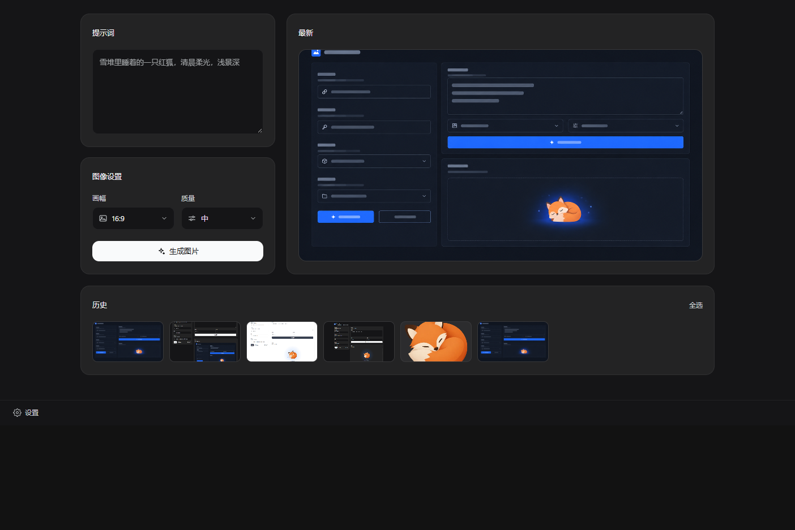
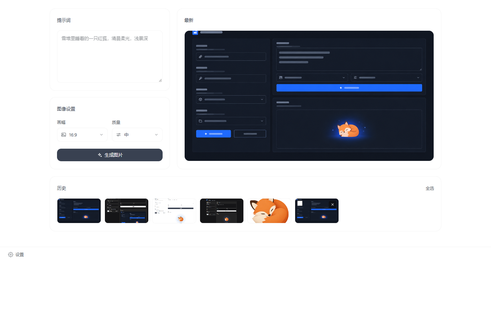
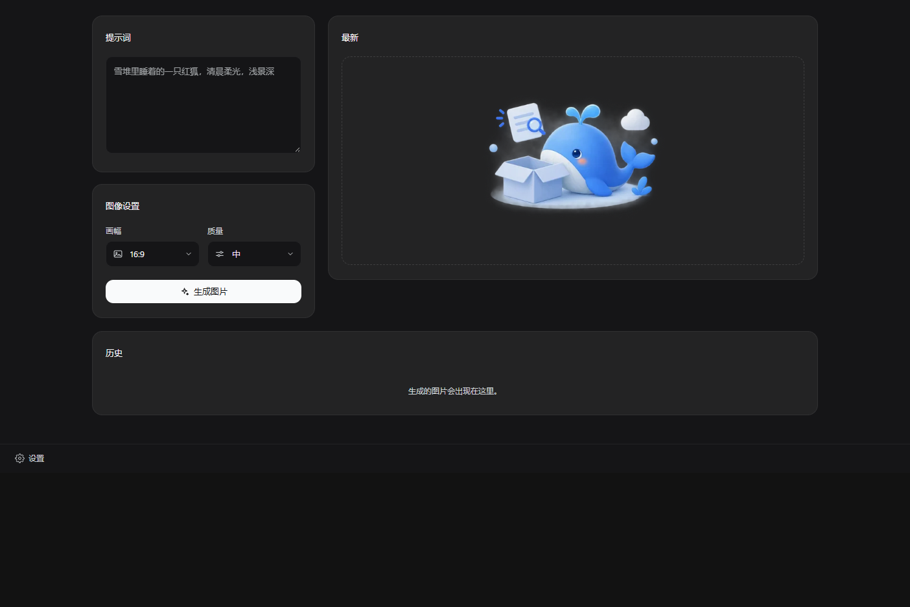
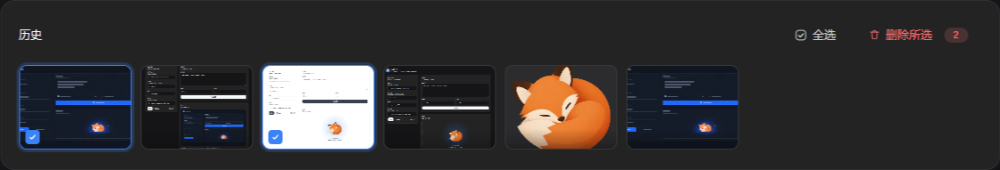
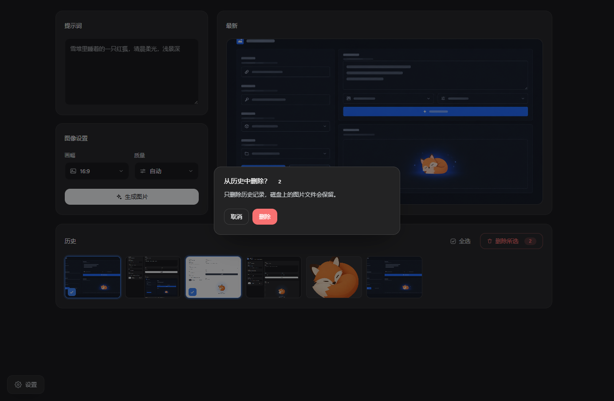
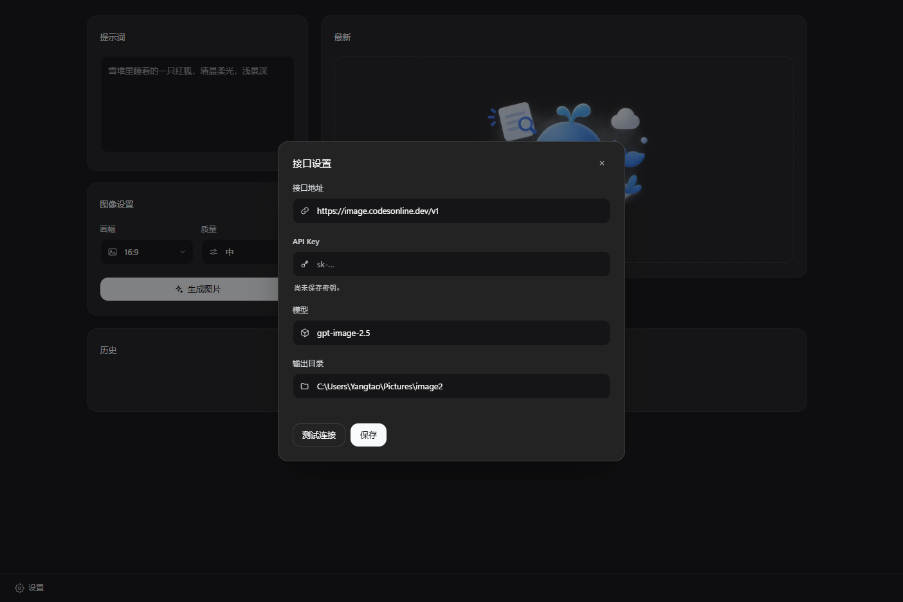
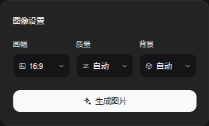
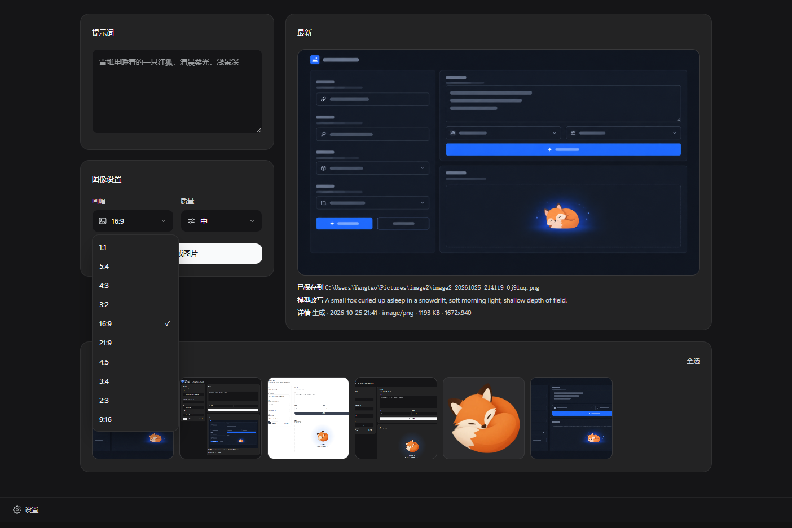
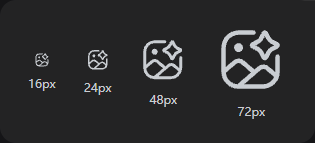

# Image studio（图像生成）

一个 DSH Harness 插件：在 Web UI 左侧栏新增「图像生成」页面，填写**接口地址**与 **API Key** 后，
输入提示词即可调用生图接口，图片会保存到本地并进入页面右侧的画廊。

同时注册两个 agent 工具——`image2_generate`（生成）与 `image2_edit`（改图）——复用同一套配置。

## 使用

1. 打开左侧栏的「图像生成」图标。**第一次进入会自动弹出接口设置**；已经配好密钥时，设置收在
   左下角的「设置」按钮里。
2. 设置里填写：
   - **接口地址**：生图接口的基础地址，例如 `https://api.openai.com/v1`。
     也可以直接粘贴完整路由 `https://api.openai.com/v1/images/generations`，插件会自动截掉后缀。
   - **API Key**：只需填写一次，保存后不再回显（页面只显示掩码提示）。
   - **模型**：默认 `gpt-image-2.5`。
   - **输出目录**：默认 `~/Pictures/image2`，支持以 `~` 开头的路径。
3. 点「保存」（第一次保存后弹窗会自己关掉），可先点「测试连接」确认地址与密钥可用（探测 `{接口地址}/models`）。
4. 左列写提示词、选画幅、质量与背景，点「生成图片」。三者默认 **16:9 / 自动 / 自动**（存在 profile 里，
   页面上切换后只影响本次，不改设置文件）。背景取 `自动 / 透明 / 不透明`：选「透明」时接口返回带 alpha
   的 PNG，适合做空态插图、贴纸这类要抠底的素材（接口是否支持取决于你自己的服务实现）。
5. 右列是最新一张图，和左边「提示词 + 图像设置」两栏等高：图片按容器铺满显示（`object-fit: cover`），
   不附带路径、改写、文件信息。下面是通栏的历史画廊，缩略图按 4:3 一行 8 张：
   - **选**：鼠标移到缩略图上，底部滑出工具条——底衬是一条自下而上渐隐的暗色蒙层（底部最深、向上
     淡到全透明，没有硬边），左边勾选框、右边垃圾桶。点勾选框或直接点缩略图都能选中/取消；选中的图在
     指针移开后只留底部左侧的勾选标记（蒙层与垃圾桶隐去，不压图）；卡片右上角的「全选」一次选中全部，
     满选后变成「取消选择」；
   - **删一张**：工具条右侧的垃圾桶按钮；
   - **批量删**：选中若干（或全选）后点右上角红色的「删除所选 / 全部删除」；
   - 两种删除都会先弹**二次确认**（列出数量，说明只删记录、不动文件），确认后才真正移除。

历史只删除记录，**磁盘上的图片文件不会被删**。

## 实现

| 部分 | 位置 | 说明 |
| --- | --- | --- |
| Host 半 | `index.js` | 读写设置与历史；在 `/api/image2/*` 上注册六个需要鉴权的路由；注册两个工具 |
| Client 半 | `client.js` | `sidebar.panellist` 图标 + 以 `image2` 为 key 的 `main` 页面 |
| 组合 | `cordis.patch.yml` | 插入一行 `id: image2` 的插件行 |

路由（都在 Connection 的 `/api` 鉴权通道上，浏览器同源 `fetch` 即可）：

- `GET|POST /api/image2/settings` — 读取/更新设置；`POST` 只写入传入的字段。
- `POST /api/image2/test` — 探测 `{接口地址}/models`。
- `POST /api/image2/generate` — 调用 `{接口地址}/images/generations`（`response_format: b64_json`），
  写盘后返回 `{ item, items }`：新记录与刷新后的整份历史。
- `GET /api/image2/history` — 历史列表，新的在前。
- `POST /api/image2/history/delete` — 按 `{ ids: [...] }` 删除记录，返回剩余历史。
- `GET /api/image2/asset?id=` — 回传某条记录的图片字节（`` 直接用它，页面因此不必在 JSON 里搬运 base64）。

工具：

- `image2_generate(prompt, size?, quality?, background?, outputDir?)` — 生成一张并返回落盘路径。
- `image2_edit(image, prompt, mask?, size?, quality?, background?, outputDir?)` — 调 `/images/edits` 改图，
  结果写成**新文件**，原图不动。

`background` 取 `auto`（默认）/ `transparent` / `opaque`：`transparent` 出带 alpha 的 PNG（做空态插图、贴纸
这类素材时用），`opaque` 强制不透明，`auto` 交给接口决定。不传时用设置里保存的值，设置里也没有就按
`auto`。页面本身没有这个开关，只对两个工具和 `POST /api/image2/generate` 生效。

工具在**工作区**里调用时默认写入 `<工作区>/imgout`（而不是设置里的图片目录），这样 agent 生成的图
就落在它的工作旁边；显式传 `outputDir` 时以参数为准。

## 界面

页面样式不是凭空写的：先用 `gpt-image2` 生成一张界面设计稿，再照着稿子在 `client.js` 里还原。
版面是两行：第一行左边是「提示词 + 图像设置」，右边是「最新」那张图——两栏**底部对齐**（网格
`align-items: stretch`，左列最后一张卡吃掉余量），图片 `object-fit: cover` 铺满卡片；
第二行是通栏的「历史」画廊，缩略图固定 4:3、宽屏一行 8 张。页面不放大标题，也没有空态文案。

- 只用 Harness 自己的设计变量（`--dsw-alias-*`）和 `ui-primitives` 的 `Button`，深浅两套主题都跟随应用。
- 唯一的固定色是这个插件的品牌蓝 `#3b82f6`，只在聚焦描边、选中描边、选中数量胶囊上出现；
  主按钮仍然用 `Button variant="primary"`，因此和其它页面保持一致。
- 空态插图来自 `design/empty.webp`（600px 透明 WebP），缩到 400px 宽后以 data URL 内联进 `client.js`
  （页面因此不需要额外的静态资源路由）。
- 侧栏图标是给定的那枚「相框 + 山 + 星」形状，用 `currentColor` 单色填充，因此选中态跟随侧栏自己的配色。
- 画幅、质量与背景不是原生 `<select>`：它们的弹层直接用宿主的 `Menu` 基元（`ui-primitives`），
  因此卡片、行高、悬停底色、右侧勾选和应用里其它下拉菜单完全一致；触发器仍是本页的输入框样式，
  通过 `portal` 渲染到 `body`，不会被面板的滚动容器裁掉。三项并排一行，该行的触发器收窄了内边距与
  图标尺寸，最长的「不透明」也不会被截断（英文用 Auto / Clear / Solid 这三个短词）。
- 设置弹窗是 `position:fixed` + `createPortal` 到 `body` 的自绘对话框，不依赖宿主的 `Modal`，
  这样它不会被页面容器的 `overflow` 或层叠顺序裁掉。




















`design/` 里是这些素材与开发工具：

| 文件 | 用途 |
| --- | --- |
| `comp.png` | `gpt-image2` 生成的界面设计稿，还原时照着它写 |
| `preview.html` | 开发预览：用 React + 假的 slots/locale/Button/Menu/fetch 直接渲染 `client.js`，可截图比对设计稿（`Menu` 替身只模拟 props 与行结构，卡片外观来自宿主基元，预览里不作为视觉依据） |
| `serve.mjs` | 预览用的本地服务：静态文件 + `/api/image2/asset`（`` 不走 `fetch`，必须有真实路由） |
| `vendor/` | 预览页用的 React 18.3.1 UMD 构建（原本从 unpkg 拉，离线会白屏，现改为本地文件） |
| `check-client.mjs` | 无浏览器自检：中英词条是否对齐、代码里用到的 key 是否都存在、slot 是否注册 |
| `empty.webp` | 空态插图原图（600×499 透明） |
| `empty-inline.webp` | 实际内联的那份：缩到 400px 宽、WebP q84 |
| `empty-dataurl.txt` | 上面那份的 data URL |
| `inline-art.mjs` | 把 `empty-dataurl.txt` 写回 `client.js` 的 `ART_EMPTY` |
| `fox.webp` | 更早一版的空态插图，现已不用，仅留档 |
| `shots/` | 截图：深色画廊、浅色画廊、深色空态、勾选与批量删除入口、工具条渐变、二次确认弹窗、设置弹窗、图像设置、画幅下拉、图标各尺寸；另有三张旧图兼作预览页里的历史缩略图 |

改完 `client.js` 想看效果，不必反复装插件：

```powershell
node design/serve.mjs 39181
# 打开 http://127.0.0.1:39181/design/preview.html
```

`?theme=light|dark`、`?lang=en|zh`、`?nokey=1`（模拟未配置密钥，弹窗自动打开）、
`?empty=1`（模拟空历史）。换了插图就跑一次 `node design/inline-art.mjs`。
这个预览页只替代宿主环境，不是插件的运行方式。

## 设置与历史存储

都在 `$DSH_PROFILE_DIR/image2/`（未设置该环境变量时回落到 `~/.dsh/image2/`）：

- `settings.json` — 写入时使用 `0600` 权限。API Key 只存在于这个文件与插件进程内存中：
  - 接口永远不把 Key 回传给浏览器，只返回 `hasApiKey` 与形如 `••••abcd` 的掩码。
  - Key 在每次调用时重新读取，因此保存后立刻对下一次生成、`image2_generate` 与 `image2_edit` 生效，无需重启。
  - 删除密钥：页面上的「删除密钥」，或直接删除该 `settings.json`。
  - 除地址/模型/输出目录外，还存 `size`、`quality`、`background` 三个偏好（默认 `16:9` / `auto` / `auto`）；
    工具调用时显式传参优先，其次是这里的值，最后才是代码默认值。
- `history.json` — 画廊记录（最多 200 条，新的在前），每条含 id、绝对路径、媒体类型、字节数、
  提示词、模型改写、生成方式（`generate` / `edit`）与时间。文件损坏时按空画廊处理。
  删除记录只改这个文件，图片本体留在原处。

## 注意

- 「测试连接」依赖接口实现 `/models`；部分兼容实现没有该路由，此时测试会报错，但不影响生成。
- 接口地址由使用者自己填写，插件只按 `{接口地址}/images/generations` 与 `/images/edits` 约定拼接；
  这是本机发起的出站请求，请只填写你信任的地址。
- 生成是慢请求（默认 180 秒超时），期间按钮处于禁用状态。

## 开发自测

- `node smoke.mjs`——在本机临时目录里起一个假的生图接口，跑通「设置读写 → 探测 → 生成落盘 → 历史/素材/
  删除 → 两个工具（含工作区 `imgout` 默认目录、multipart 改图）→ 各类错误分支」。它把
  `DSH_PROFILE_DIR` 指向临时目录，因此不会碰真实配置，也不访问外网。
- `node design/check-client.mjs`——加载 `client.js` 的工厂函数（stub 掉 React 与 slots），检查
  中英词条键一致、无缺失/无冗余、`main` 与 `sidebar.panellist` 都已注册。
